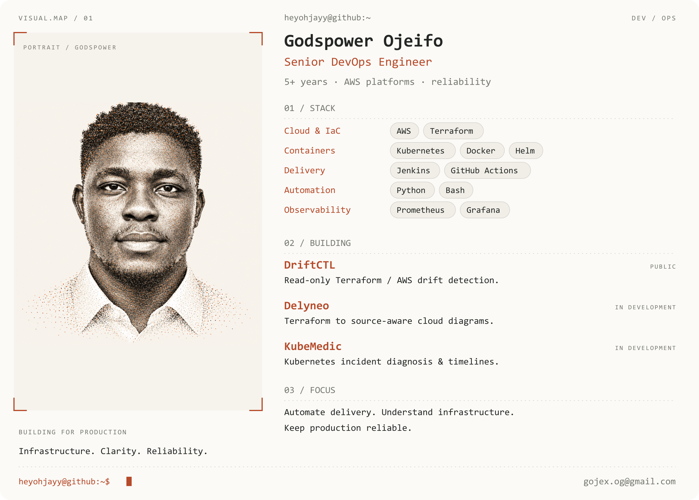

<picture>
  <source media="(prefers-color-scheme: dark)" srcset="assets/profile-dark.png">
  
</picture>

  <a href="https://www.linkedin.com/in/godspowerojeifo/">LinkedIn</a> ·
  <a href="mailto:gojex.og@gmail.com">Email</a> ·
  <a href="https://github.com/heyohjayy/DriftCTL">DriftCTL</a> ·
  <a href="https://github.com/heyohjayy/server-operations-toolkit">Server Operations Toolkit</a> ·
  <a href="https://github.com/heyohjayy?tab=repositories">More work</a>

About &amp; projects (text version)

I'm Godspower Ojeifo, a Senior DevOps Engineer with 5+ years of experience building reliable AWS infrastructure and automating software delivery. My work spans Terraform, Kubernetes, CI/CD, observability, security and Bash/Python automation.

- **[DriftCTL](https://github.com/heyohjayy/DriftCTL)** — read-only, policy-driven drift detection between Terraform state and live AWS resources, with risk classification and remediation planning.
- **Delyneo** *(in development; private repository)* — turns Terraform projects, plans and architecture graphs into readable cloud diagrams with diagnostics and source traceability.
- **KubeMedic** *(in development; private repository)* — Kubernetes incident diagnosis, evidence collection and timeline analysis.
- **[Server Operations Toolkit](https://github.com/heyohjayy/server-operations-toolkit)** — Bash utilities for Linux health checks, networking, services and storage operations.
- **[Voting App Deployment](https://github.com/heyohjayy/voting-app-deployment)** — microservices deployment and DevSecOps pipeline automation.

