<a href="https://heyohjayy.github.io/heyohjayy/">
  <picture>
    <source media="(prefers-color-scheme: dark)" srcset="https://raw.githubusercontent.com/heyohjayy/heyohjayy/9b1df9dba11f427b73f6ebef47dc74b149dbfa59/assets/profile-dark.svg">
    
  </picture>
</a>

<a href="https://heyohjayy.github.io/heyohjayy/">Open the interactive profile ↗</a> · Website

<a href="https://heyohjayy.github.io/heyohjayy/#activity-title">
  <picture>
    <source media="(prefers-reduced-motion: reduce)" srcset="assets/contributions-static.svg">
    
  </picture>
</a>

  <a href="https://www.linkedin.com/in/godspowerojeifo/">LinkedIn</a> ·
  <a href="mailto:gojex.og@gmail.com">Email</a> ·
  <a href="https://github.com/heyohjayy/DriftCTL">DriftCTL</a> ·
  <a href="https://github.com/heyohjayy/server-operations-toolkit">Server Operations Toolkit</a> ·
  <a href="https://github.com/heyohjayy?tab=repositories">More work</a>

